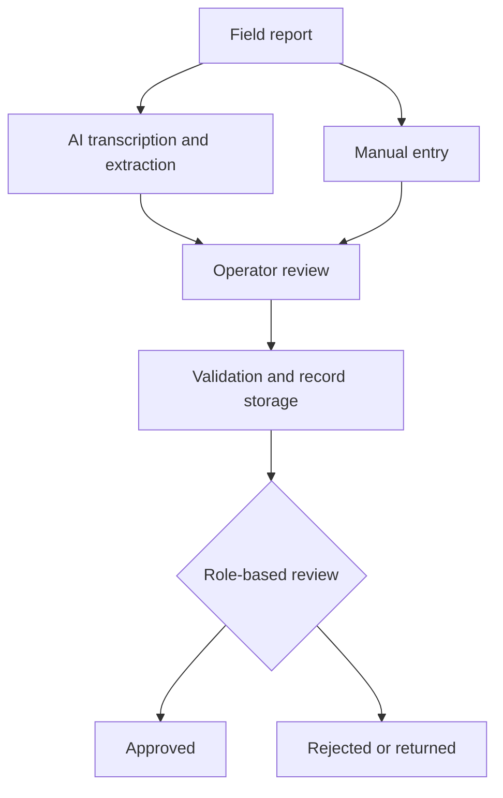

# Farm Voice Logger | יומן שדה

**From Hebrew speech to a structured field record, with human review and role-based approval.**

**Idan Ben Hanan | Business Operations · Process Design · AI Implementation**

A course MVP built step by step with AI development tools. This is a curated portfolio with selected source files and a case study, rather than the complete deployable application. It demonstrates business process definition, AI-assisted delivery and operational controls.

## הבעיה והפתרון

תיעוד טיפולים חקלאיים בשטח נעשה לעיתים בדיעבד ובפורמט לא אחיד. המטרה היא לאפשר לעובד לתעד בזמן העבודה, ולמנהל לקבל רשומה מובנית לבדיקה.

**יומן שדה** מקבל דיווח קולי בעברית על טיפול בכרם אבוקדו, מתמלל ומחלץ נתונים לטיוטה. העובד בודק ומשלים פרטים; בדיקות קוד בוחנות תקינות; מנהל או אגרונום מאשר או דוחה לפי תפקיד.

## התרומה שלי

הובלתי את בניית הפרויקט צעד אחר צעד בעזרת כלי AI במסגרת קורס מיישמי AI לארגונים. התמקדתי בהגדרת המשתמשים, תהליך העבודה, שדות הרשומה, אחריות בעלי התפקידים, נקודות הבקרה וההדגמה.

הפרויקט מחבר את הניסיון שלי בניהול תפעול לאפיון ולהובלת בניית פתרון טכנולוגי. המימוש נבנה בסיוע AI; הוא מוצג כפרויקט קורס ותיק עבודות, ללא טענה להטמעה ארגונית בפרודקשן או לכתיבה עצמאית של כל הקוד.

## מסלול קריאה למגייס

| זמן | מה לראות |
|---|---|
| דקה | הבעיה, הפתרון והתרומה האישית בעמוד זה |
| 3 דקות | [תיאור המקרה ותסריט הדמו](docs/CASE_STUDY.md) |
| סקירה טכנית | [מפת הקוד והתלויות](code/README.md) |
| דיון מקצועי | [ראיות בדיקה, מגבלות והמשך עבודה](docs/REVIEW_NOTES.md) |

התרשים מציג את תהליך היעד. בדיקת הקוד זיהתה פערים הדורשים טיפול לפני שימוש ארגוני, כמפורט במסמך הסקירה.

## רכיבים וטכנולוגיות

| תחום | טכנולוגיה או יכולת |
|---|---|
| ממשק הפרויקט המלא | React, TypeScript, Vite, Tailwind ו-RTL |
| שרת ונתונים | Express, PostgreSQL, Drizzle ORM |
| תמלול | OpenAI `gpt-4o-mini-transcribe` |
| חילוץ | OpenAI `gpt-4o-mini` |
| בקרות | JWT, הרשאות תפקיד, בדיקות קלט ואישור אנושי |
| התמודדות עם ניתוק | תור מקומי וניסיון סנכרון |
| חוזה API בפרויקט המלא | OpenAPI, Zod ו-React Query |

## מה נמצא במאגר הציבורי

- חמישה קובצי מקור נבחרים: תהליך AI, הרשאות, רשומות ואישור, תור מקומי וסנכרון.
- תיאור מקרה עסקי, תסריט דמו ומדדים לפיילוט.
- מפת תלויות וממצאי סקירה, כולל פערים ידועים.

הקבצים נבחרו מתוך גרסת הפרויקט הזמינה ב-24.11.2026, ללא העברת היסטוריית הגרסאות הישנה. אין כאן מסד נתונים, חשבונות משתמשים, סיסמאות, מפתחות API או חבילת פריסה מלאה.

## תוצאות ומצב

דו״ח פנימי מ-19.09.2026 מתעד דמו בסביבת פיתוח: עיבוד קול, תיקון ושמירה, אישור מנהל, יומן ביקורת ושמירה וסנכרון לאחר ניתוק. זו תוצאה היסטורית מדווחת, ולא בדיקה חוזרת של הגרסה הנוכחית.

לצורך הכנת המאגר בוצעה סקירה סטטית של הקבצים הנבחרים. לא הורצו האפליקציה, build או בדיקות אוטומטיות. טרם אומתו חיסכון עסקי, דיוק על מדגם מייצג או אימוץ בשטח.

**פערים מרכזיים להמשך:** שמירת רשומות שנכשלו בסנכרון, קיבוע סטטוס אישור בצד שרת, אימות מבנה פלט AI ומדידת איכות ועלות. פירוט ב[מסמך הסקירה](docs/REVIEW_NOTES.md).

## שימוש והדגמה

קובצי הקוד נועדו לקריאה מקצועית. חסרים במאגר זה רכיבי workspace, סכמות מסד, קוד ממשק ותצורת פריסה, ולכן אין פקודת התקנה שמפעילה כאן את המערכת המלאה.

הדגמה חיה דורשת את סביבת הפרויקט המלאה וחשבונות דמו ייעודיים. המערכת מתעדת טיפול; פלט ה-AI אינו המלצה לחומר או למינון. עיבוד קול דורש חיבור לרשת גם כאשר קיימת שמירה מקומית של רשומות.

**קשר מקצועי:** [עידן בן חנן בלינקדאין](https://www.linkedin.com/in/idanbenhanan/)

Copyright © 2026 Idan Ben Hanan. All rights reserved. See [LICENSE](LICENSE).
